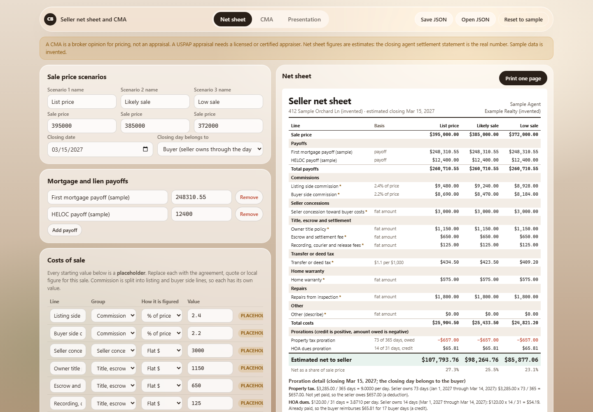

# Seller Net Sheet and CMA

[](https://github.com/chasebuilds/seller-net-sheet-cma/actions/workflows/ci.yml)
[](LICENSE)

**Live demo: https://chasebuilds.github.io/seller-net-sheet-cma/**

A browser tool for listing agents. It builds a seller net sheet with three price scenarios side by side, and a CMA listing presentation you can print as a PDF. Nothing is uploaded: it runs in your browser.

> **A CMA is a broker opinion for pricing a listing. It is not an appraisal.** A USPAP appraisal needs a licensed or certified appraiser. **Net sheet figures are estimates.** The closing agent's settlement statement is the real number.



## What it does

**Net sheet**
- List price, likely sale and low sale scenarios side by side.
- One or more mortgage and lien payoffs.
- Listing side and buyer side commission as separate lines. Each is a percent or a flat amount you set. No rate is built in as a norm.
- Seller concessions, title and escrow fees, transfer or deed tax (flat, percent, or dollars per $1,000), home warranty, repairs, and any other lines you add.
- Property tax and HOA proration by closing date. It shows the day count and the formula for every item (see below).
- Every line is shown, then the estimated net to the seller in dollars and as a share of the price.
- Save the whole job as JSON and open it later. Print a one-page PDF from the browser.

**CMA presentation**
- Upload a comps CSV, paste rows, or use the invented sample.
- Pick which sold comps to use. See price per square foot as a chart, the active, pending, sold and expired breakdown, days on market, and list-to-sale ratio.
- Enter simple adjustments: dollars per square foot, bedroom, bathroom, year of age, a monthly market change, and a free "other" amount per comp.
- Get a suggested list price range, then send it to the net sheet scenarios with one button.
- Print a 7-page listing presentation: cover, subject, market activity, comps table, charts, pricing, net sheet.


## How the proration works

Actual-day method. The bill for a period (a tax year, a fiscal year, a month of HOA dues) is split by the real calendar days in that period, so a leap-year period counts 366 days.

- Days in period = end date minus start date, plus 1.
- Seller days = closing date minus start date. The closing day belongs to the buyer unless you switch it to the seller (then add 1).
- Seller share = bill x seller days / days in period, rounded to cents.
- Not yet paid: the seller owes the seller share (a deduction). Already paid: the buyer reimburses the buyer share (a credit).

Worked example, checked by hand in the tests: a $3,650 tax bill for 2027, closing July 11, 2027. Days in period 365, seller days 191 (Jan 1 through Jul 10), $10.00 a day, seller owes $1,910.00. For 2028, a leap year, a $3,660 bill is also $10.00 a day over 366 days, and a March 1 closing is 60 seller days, $600.00.

Some places prorate on a 360-day year or use other rules. This tool does not. Check your local practice and the settlement statement.

## Comps CSV columns

Header names are matched loosely (case and punctuation are ignored, so `Sq Ft`, `Close Price` and `DOM` work). Comma, tab and semicolon files all load. Rows it cannot use are skipped and listed with the reason.

| Column | Needed | Notes |
|---|---|---|
| `address` | yes | Any label you will recognize. |
| `status` | yes | active, pending, sold or expired. Also read: closed, under contract, contingent, withdrawn, cancelled. |
| `sqft` | yes | Commas and "sf" are fine. Under 100 or over 50,000 is rejected as a typo. |
| `sold_price` | sold rows | Closed price. |
| `list_price` | other rows | Final list price. Also gives the list-to-sale ratio on sold rows. |
| `beds`, `baths`, `year_built` | no | Used for adjustments. |
| `list_date`, `sale_date` | no | `YYYY-MM-DD` or `M/D/YYYY`. `sale_date` drives the time adjustment. |
| `days_on_market` | no | Counted from the two dates if blank. |
| `lat`, `lng` | no | Draws the relative location plot. It is not a street map. |
| `notes` | no | Free text. |

`samples/comps-sample.csv` is a working file. `samples/comps-messy.csv` is the test file with quoted commas, `$` signs, "1,150 sf", `$300k`, blanks and bad rows.

## How the price range is figured

Adjusted price = sold price + adjustments (subject minus comp, times your rate). Only sold comps you tick are used. With 4 or more, the range is the 25th to 75th percentile of adjusted prices with the median as the middle. With fewer than 4, it is lowest to highest. The tool warns when fewer than 3 are selected. Active, pending and expired listings are shown for context and are never used for the range.

## Placeholders you must replace

Every starting cost rate and adjustment rate is a **placeholder**, marked in the form and with an asterisk on the printed sheet until you edit it. The commission, title, escrow, transfer tax, warranty and repair figures, and the per-square-foot, bedroom, bathroom and age adjustments, are made-up sample values. They are not market data and not a typical rate. Replace each with your listing agreement, quotes and local figures. The sample property, comps, people and brokerage are all invented.

## Run it

```
npm install
npm run dev        # local server
npm test           # 49 tests
npm run build      # static site in dist/
```

Printing: use the **Print one page** or **Print presentation** button, then Save as PDF at Letter size with headers and footers off.

## Checks

- 49 tests: proration (leap and non-leap years, fiscal year across a leap day, first and last day of a period, closing-day owner, rounding), net totals for all three scenarios, CSV parsing of messy input, adjustments, price range, and JSON save and load. The expected values in them are worked out by hand in the test comments.
- Print output measured with headless Chromium: the net sheet prints as 1 page and the presentation as 7 pages.
- Production bundle: 47.6 kB JavaScript (16.5 kB gzip), 11.0 kB CSS.

## Limits

- Settlement fees, tax rules and commission arrangements differ by place and deal. This tool does not know yours.
- No MLS connection. Comps come from your own CSV.
- Adjustments are simple linear rates, not a paired-sales analysis.
- The saved JSON and the browser's local storage hold whatever you typed. Do not share a file that has a client's details.

## License

MIT. Copyright Chase Builds.
