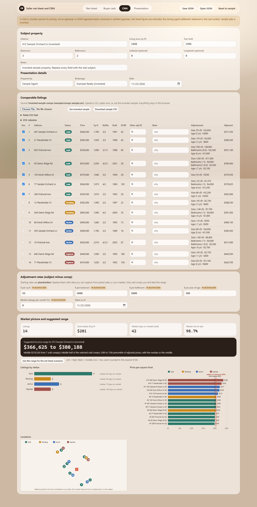

# Seller Net Sheet and CMA

[](https://github.com/chasebuilds/seller-net-sheet-cma/actions/workflows/ci.yml)
[](LICENSE)

**A listing agent's net sheet, buyer cash-to-close estimate and CMA listing presentation. It runs in your browser and prints to PDF. Nothing is uploaded.**

**Live demo: https://chasebuilds.github.io/seller-net-sheet-cma/**


> **A CMA is a broker opinion for pricing a listing. It is not an appraisal.** A USPAP appraisal needs a licensed or certified appraiser. **Net sheet and cash-to-close figures are estimates.** The closing agent's settlement statement, and the lender's Closing Disclosure for the buyer, are the real numbers.

<!-- bench:start -->
Checked against an independent reference: 20000 of 20000 generated prorations (actual-day and 360-day, 3131 spanning a Feb 29) and 15000 of 15000 net totals match to the cent; 43624 of 43624 generated messy CSV rows parse exactly and 2997 of 2997 bad rows are skipped with a warning. Details: [BENCHMARK.md](BENCHMARK.md).
<!-- bench:end -->

## What you get

| Tab | What it does |
|---|---|
| **Net sheet** | List, likely and low sale prices side by side. Payoffs, listing side and buyer side commission as separate lines, concessions, title and settlement fees, transfer tax, warranty, repairs, other lines. Property tax and HOA proration by closing date with the day count and formula shown. Every line, then net to seller. Save as JSON, print one page. |
| **Buyer cash** | The same three prices from the buyer's side: down payment, loan costs, prepaids, escrow reserves, buyer-side title fees, minus earnest money, seller concessions and prorations. Estimated cash to close. Print one page. |
| **CMA** | Load a comps CSV or the invented sample. Pick comps, enter adjustments, see price per square foot, active/pending/sold/expired counts, days on market, list-to-sale ratio and a suggested list price range. One button sends the range to the net sheet. |
| **Presentation** | A 7-page listing presentation: cover, subject, market activity, comps table, charts, pricing, net sheet. Print to PDF. |



## Proration: two methods, formula shown

The bill for a period (a tax year, a fiscal year, a month of HOA dues) is split by the days the seller owned. The closing day belongs to the buyer unless you switch it. Not yet paid: the seller owes the seller share. Already paid: the buyer reimburses the buyer share. Amounts are in whole cents and half a cent rounds up.

| Method | Day count | Example |
|---|---|---|
| **Actual days** (default) | Real calendar days, so a leap-year period is 366. | $3,650 for 2027, closing July 11: 191 of 365 days at $10.00 a day, seller owes $1,910.00. |
| **360-day banker year** | 30/360: every month is 30 days, a 31st counts as the 30th. | $3,600 for 2027, closing July 1: 180 of 360 days at $10.00 a day, seller owes $1,800.00. |

Switch the method on the net sheet tab. The formula and day count show under each item and on the printed sheet. Local practice varies, so use the method your contract and closing agent use.

## Comps CSV columns

Header names are matched loosely (case and punctuation are ignored, so `Sq Ft`, `Close Price` and `DOM` work). Comma, tab and semicolon files all load. Rows it cannot use are skipped and listed with the reason.

| Column | Needed | Notes |
|---|---|---|
| `address` | yes | Any label you will recognize. |
| `status` | yes | active, pending, sold or expired. Also read: closed, under contract, contingent, withdrawn, cancelled. |
| `sqft` | yes | Commas and "sf" are fine. Under 100 or over 50,000 is rejected as a typo. |
| `sold_price` | sold rows | Closed price. |
| `list_price` | other rows | Final list price. Also gives the list-to-sale ratio on sold rows. |
| `beds`, `baths`, `year_built` | no | Used for adjustments. |
| `list_date`, `sale_date` | no | `YYYY-MM-DD` or `M/D/YYYY`. `sale_date` drives the time adjustment. |
| `days_on_market` | no | Counted from the two dates if blank. |
| `lat`, `lng` | no | Draws the relative location plot. It is not a street map. |
| `notes` | no | Free text. |

`samples/comps-sample.csv` is a working file. `samples/comps-messy.csv` has quoted commas, `$` signs, "1,150 sf", `$300k`, blanks and bad rows.

## How the price range is figured

Adjusted price = sold price + adjustments (subject minus comp, times your rate). Only sold comps you tick are used. With 4 or more, the range is the 25th to 75th percentile of adjusted prices with the median as the middle. With fewer than 4, it is lowest to highest. The tool warns when fewer than 3 are selected. Active, pending and expired listings are shown for context and never used for the range.

## Placeholders you must replace

Every starting cost rate and adjustment rate is a **placeholder**, marked in the form and with an asterisk on the printed sheet until you edit it. That covers commission, title, escrow, transfer tax, warranty, repairs, the buyer-side lines, and the per-square-foot, bedroom, bathroom and age adjustments. They are made-up sample values, not market data and not a typical rate. Replace each with your listing agreement, quotes, lender estimate and local figures. The sample property, comps, people and brokerage are all invented.

## Run it

```
npm install
npm run dev         # local server
npm test            # unit tests, expected values worked out by hand in comments
npm run benchmark   # rewrites BENCHMARK.md and the measured line above
npm run build       # static site in dist/
```

Printing: use a **Print one page** or **Print presentation** button, then Save as PDF at Letter size with headers and footers off.

## Limits

- Settlement fees, tax rules and commission arrangements differ by place and deal. This tool does not know yours.
- No MLS connection. Comps come from your own CSV.
- Adjustments are simple linear rates, not a paired-sales analysis.
- The buyer sheet estimates cash to close from lines you enter. It is not a Loan Estimate.
- The saved JSON and the browser's local storage hold whatever you typed. Do not share a file that has a client's details.

## License

MIT. Copyright Chase Builds.

## More from Chase Builds

- **[comparable-sales-grid](https://github.com/chasebuilds/comparable-sales-grid)**: Picks comps, adjusts each line with rates measured from your own sales, and gives a value range. Within 5% on 93.0% of test homes. ([live demo](https://chasebuilds.github.io/comparable-sales-grid/))
- **[listing-kit](https://github.com/chasebuilds/listing-kit)**: One file becomes a listing website with gallery, map and flyer, plus a fair-housing wording checker. ([live demo](https://chasebuilds.github.io/listing-kit/))
- **[showing-route-planner](https://github.com/chasebuilds/showing-route-planner)**: Orders a day of showings around every listing window with the least driving. Works offline on a phone. ([live demo](https://chasebuilds.github.io/showing-route-planner/))

[All projects, sorted by industry](https://github.com/chasebuilds) · [chasebuilds.github.io](https://chasebuilds.github.io)
